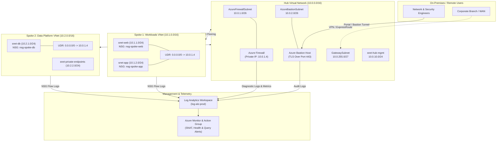
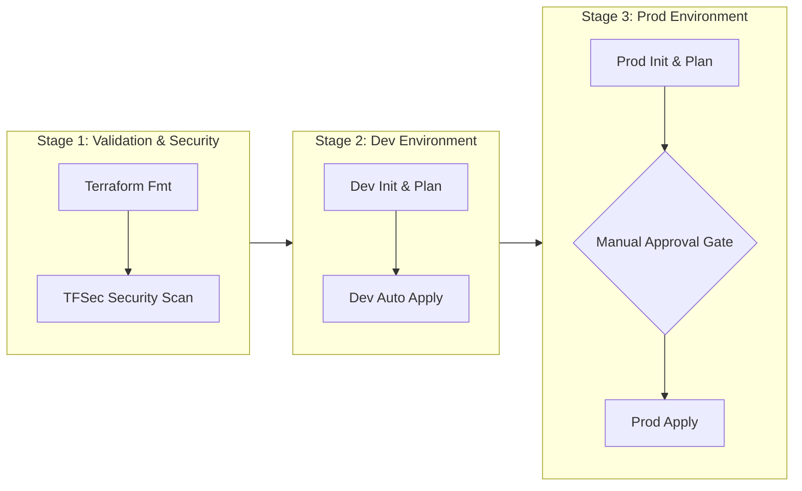

# Low-Level Design (LLD): Enterprise Azure Landing Zone

**Document Version:** 1.0.0  
**Target Architecture:** Microsoft Cloud Adoption Framework (CAF) Hub-and-Spoke  
**IaC Tooling:** Terraform (Modular)  
**CI/CD Orchestration:** Azure DevOps YAML Multi-Stage Pipelines  

---

## 1. Executive Summary & Objective

The objective of this project is to provision an enterprise-grade, secure, compliant, and repeatable **Azure Landing Zone (ALZ)** based on a Hub-and-Spoke network topology. 

Key architectural requirements fulfilled:
- **Centralized Network Egress & Inspection:** Centralized traffic filtering through **Azure Firewall Standard** with application and network rule collection groups.
- **Micro-Segmentation:** Distributed **Network Security Groups (NSGs)** enforcing least-privilege traffic flow between subnets.
- **Zero Public IP Management:** Secure RDP/SSH access to VMs provided via **Azure Bastion Standard** with TLS tunneling and copy-paste control.
- **Traffic Redirection (UDR):** Spoke outbound traffic and inter-spoke communications routed via User Defined Routes (UDRs) through Azure Firewall.
- **Centralized Telemetry & Observability:** **Azure Log Analytics Workspace** and **Azure Monitor** configured with active health alerts and query rules.
- **Identity & Access Governance:** Azure RBAC mappings aligned to separation of duties.
- **Automated Delivery:** Declarative multi-stage Azure DevOps YAML pipeline supporting linting, security scanning (`tfsec`), plan artifact publishing, and gated manual approval deployments.

---

## 2. Architecture Diagram (Mermaid)

---

## 3. IP Addressing Scheme & Subnet Allocation

### 3.1 Hub Network (`10.0.0.0/16`)
| Subnet Name | CIDR Prefix | Available IPs | Purpose |
| :--- | :--- | :--- | :--- |
| `AzureFirewallSubnet` | `10.0.1.0/26` | 59 | Azure Firewall core instance & private interfaces |
| `AzureBastionSubnet` | `10.0.2.0/26` | 59 | Azure Bastion scale units |
| `GatewaySubnet` | `10.0.255.0/27` | 27 | Virtual Network Gateway / ExpressRoute Gateway |
| `snet-hub-mgmt` | `10.0.10.0/24` | 251 | Jump boxes, management tooling, DNS proxies |

### 3.2 Spoke 1: Workloads Network (`10.1.0.0/16`)
| Subnet Name | CIDR Prefix | Purpose | Service Endpoints |
| :--- | :--- | :--- | :--- |
| `snet-web` | `10.1.1.0/24` | Ingress frontends, reverse proxies, web tiers | `Storage`, `KeyVault` |
| `snet-app` | `10.1.2.0/24` | Internal business logic, container apps, microservices | `Storage`, `KeyVault`, `Sql` |

### 3.3 Spoke 2: Data Platform Network (`10.2.0.0/16`)
| Subnet Name | CIDR Prefix | Purpose | Service Endpoints |
| :--- | :--- | :--- | :--- |
| `snet-db` | `10.2.1.0/24` | Database instances (Azure SQL Managed Instance, Postgres) | `Storage`, `KeyVault` |
| `snet-private-endpoints` | `10.2.2.0/24` | Private Endpoints for PaaS services | None |

---

## 4. Routing Architecture (UDR & Route Tables)

All spoke subnets have dedicated route table associations enforcing traffic through the Hub Azure Firewall:
- **Default Outbound Route (`0.0.0.0/0`):** Next Hop = `VirtualAppliance` (Firewall Private IP: `10.0.1.4`).
- **Inter-Spoke Route 1 (`10.1.0.0/16`):** Next Hop = `VirtualAppliance` (Firewall Private IP: `10.0.1.4`).
- **Inter-Spoke Route 2 (`10.2.0.0/16`):** Next Hop = `VirtualAppliance` (Firewall Private IP: `10.0.1.4`).

**Benefits:**
- Zero egress bypass to public internet.
- Deep Packet Inspection (DPI) and IDS/IPS logging on all inter-workload communications.
- Asymmetric routing prevention across VNet boundaries.

---

## 5. Network Security Groups (NSG) Rule Matrix

### 5.1 `nsg-spoke-web` (Web Tier)
| Priority | Name | Direction | Access | Protocol | Source | Destination Port | Description |
| :--- | :--- | :--- | :--- | :--- | :--- | :--- | :--- |
| `100` | `Allow-HTTPS-Inbound` | Inbound | Allow | TCP | `VirtualNetwork` | 443 | Secure web ingress from App Gateway / Load Balancer |
| `110` | `Allow-HTTP-Inbound` | Inbound | Allow | TCP | `VirtualNetwork` | 80 | HTTP ingress for SSL redirection |
| `4000` | `Deny-Direct-Internet-Inbound` | Inbound | Deny | Any | `Internet` | Any | Disallow public internet ingress |

### 5.2 `nsg-spoke-app` (Application Tier)
| Priority | Name | Direction | Access | Protocol | Source | Destination Port | Description |
| :--- | :--- | :--- | :--- | :--- | :--- | :--- | :--- |
| `100` | `Allow-Web-To-App-Inbound` | Inbound | Allow | TCP | `10.1.1.0/24` | 8080, 8443, 443 | Allow requests strictly from Web Tier |
| `4000` | `Deny-All-Other-Inbound` | Inbound | Deny | Any | `*` | Any | Default deny all unauthorized ingress |

### 5.3 `nsg-spoke-db` (Database Tier)
| Priority | Name | Direction | Access | Protocol | Source | Destination Port | Description |
| :--- | :--- | :--- | :--- | :--- | :--- | :--- | :--- |
| `100` | `Allow-App-To-DB-Inbound` | Inbound | Allow | TCP | `10.1.2.0/24` | 1433, 3306, 5432 | SQL traffic allowed strictly from Application Tier |
| `4000` | `Deny-Direct-Internet-Inbound` | Inbound | Deny | Any | `Internet` | Any | Absolute block on external internet exposure |

---

## 6. Azure Firewall Rule Configuration

Azure Firewall Policy (`afwp-hub-prod-eastus`) is partitioned into structured Rule Collection Groups:

1. **Network Rule Collection Group (`DefaultNetworkRuleCollectionGroup`, Priority 200)**:
   - `Allow-NTP`: UDP port 123 to sync internal clocks with Azure time servers.
   - `Allow-DNS`: UDP/TCP port 53 for external and internal domain resolution.
   - `Allow-Inter-Spoke-Internal`: Restricted routing between internal subnets on verified application ports (`443`, `8080`, `1433`, etc.).

2. **Application Rule Collection Group (`DefaultAppRuleCollectionGroup`, Priority 300)**:
   - `Allow-Microsoft-Updates`: Outbound HTTPS (443) to `*.microsoft.com`, `*.azure.com`, `*.windowsupdate.com`.
   - `Allow-Ubuntu-Updates`: Outbound HTTP/HTTPS to `*.archive.ubuntu.com`, `*.security.ubuntu.com`.

---

## 7. Azure Bastion Host Design

- **SKU:** `Standard`
- **Features Enabled:**
  - Copy/Paste controls.
  - Native client support (`az network bastion tunnel` / SSH / RDP direct clients).
  - Web portal TLS connectivity.
  - Scale units: Minimum 2 instances for High Availability across fault domains.
- **Zero Public IP Model:** Spoke VMs do **not** have public IP addresses (`azurerm_public_ip`). Access is brokered exclusively through the Bastion private peering topology.

---

## 8. Observability & Monitoring Matrix

| Component | Target Metric / Log Category | Alert Condition | Severity | Notification Channel |
| :--- | :--- | :--- | :--- | :--- |
| **Azure Firewall** | `FirewallHealth` | Average Health < 90% | Sev 1 (Critical) | `ag-alz-prod` Action Group |
| **Azure Firewall** | `SNATPortUtilization` | Average Utilization > 80% | Sev 2 (Warning) | `ag-alz-prod` Action Group |
| **Azure Firewall** | `AZFWNetworkRule` | Deny count > 100 within 5m | Sev 2 (Warning) | `ag-alz-prod` Action Group |
| **Azure Bastion** | `BastionAuditLogs` | Streamed real-time to LAW | N/A (Auditing) | Log Analytics Workspace |
| **Log Analytics** | Central retention | 90 days (Prod), 30 days (Dev) | Compliance | Operations Workspace |

---

## 9. Azure Role-Based Access Control (RBAC)

| Role Name | Scope | Target Assignment | Responsibilities |
| :--- | :--- | :--- | :--- |
| **Network Contributor** | `rg-hub-prod-eastus` | Core NetOps Group | Manage VNets, Peering, Route Tables, and Firewall rules |
| **Security Admin** | Hub & Spoke RGs | SecOps Team | Review NSG flows, modify firewall security policies |
| **Monitoring Reader** | `rg-operations-prod-eastus` | SRE / DevOps | View metric dashboards and alert rules |
| **Reader** | Entire Subscription | Auditor / Read-Only | Read-only compliance validation |

---

## 10. Azure DevOps Pipeline Architecture

- **Branch Protection:** Pull requests to `main` branch trigger Stage 1 validation.
- **Plan Artifacts:** Terraform plan outputs (`tfplan`) are published as immutable pipeline artifacts ensuring exact match execution between Plan and Apply stages.
- **Approval Gate:** Production deployment requires senior DevOps/SecOps sign-off configured in Azure DevOps Environment `LandingZone-Production`.

